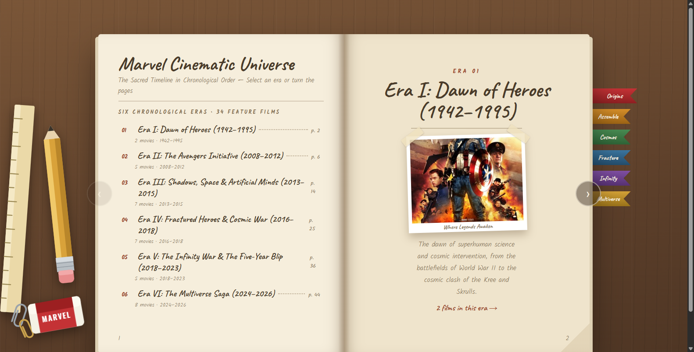
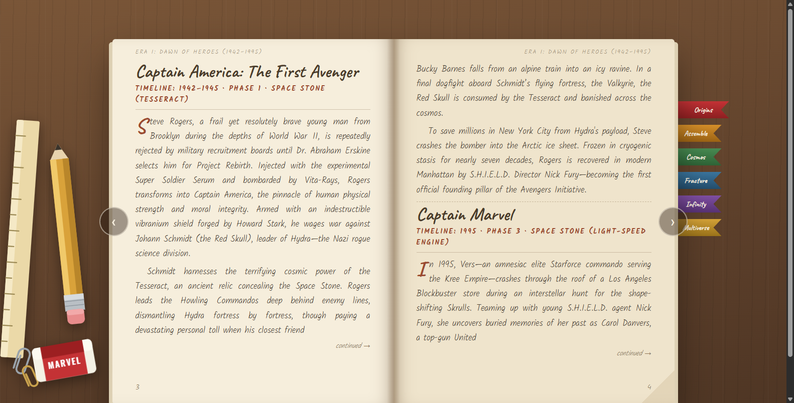
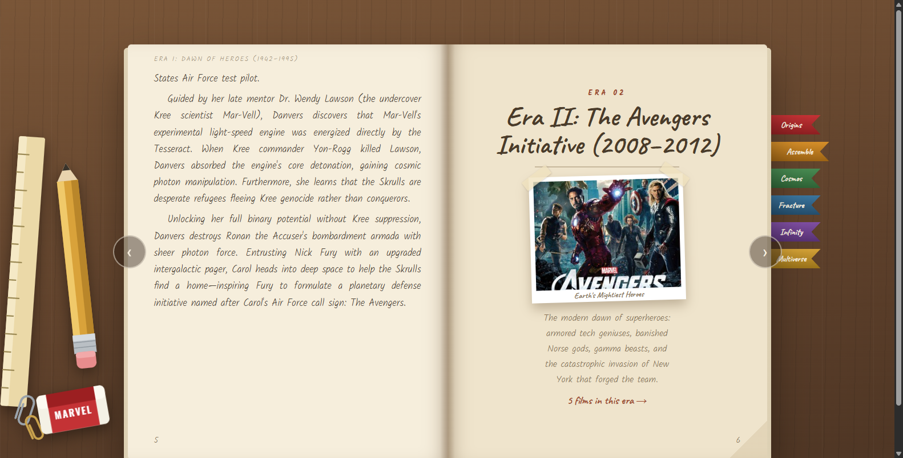
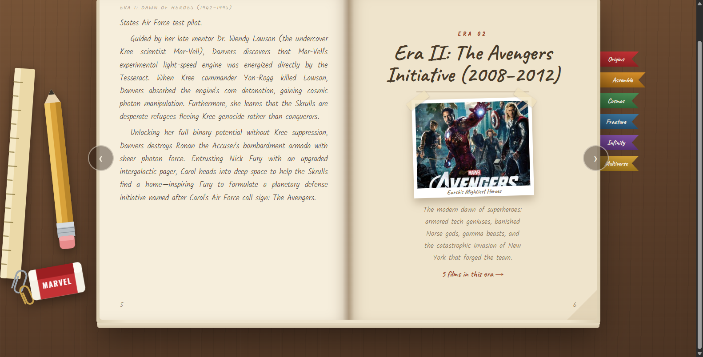

# 📖 Marvel Cinematic Universe — Chronological Timeline Book

<div align="center">

[](https://developer.mozilla.org/en-US/docs/Web/HTML)
[](https://developer.mozilla.org/en-US/docs/Web/CSS)
[](https://developer.mozilla.org/en-US/docs/Web/JavaScript)
[](LICENSE)

An interactive, vintage leather journal on a wooden desk detailing the entire Marvel Cinematic Universe in sacred chronological order, featuring realistic page-flip animations and era bookmark navigation.

<br/>



</div>

---

## 📸 Previews

| Interactive Desk & Table of Contents | Era I: Dawn of Heroes (1942–1995) |
| :---: | :---: |
|  |  |
| **Chronological Era Directory** | **Captain America & Captain Marvel** |

| Comic Illustrations & Deep Lore | Full Studio Desk Perspective |
| :---: | :---: |
|  |  |
| **Avengers Initiative & Infinity Stones** | **Woodgrain Desk with Stationery Props** |

---

## ✨ Features

- 📖 **Realistic Page-Flip Mechanics**: Turn pages with realistic 3D parchment curling and shadows.
- ⏳ **Sacred Chronological Timeline**: Traces the MCU from 1942 World War II origins up through the Multiverse Saga.
- 🔖 **Color-Coded Era Bookmarks**: Instant tab jump links for Origins, Assemble, Cosmos, Fracture, Infinity, and Multiverse.
- 🖋️ **Artisanal Desk Aesthetic**: Hand-sketched calligraphy on parchment paper with stationery props (wooden ruler, pencil, Marvel eraser).
- 💎 **Infinity Stone Lore**: Every film chronicles the timeline year, phase, and connected cosmic relics.
- ⚡ **Pure Vanilla Stack**: Zero frameworks, zero build steps — runs immediately in any browser.

---

## 🎮 Controls

| Action | Control |
| :--- | :--- |
| **Next Page** | Click the right arrow button **`>`** or click the right page edge |
| **Previous Page** | Click the left arrow button **`<`** or click the left page edge |
| **Jump to Era** | Click any colored bookmark tab along the right spine |
| **Jump to Movie** | Click any numbered film in the Table of Contents |

---

## 🚀 How to Run

1. **Option A (Direct)**: Double-click `index.html` in your file manager.
2. **Option B (Local Server)**:
   ```bash
   python -m http.server 8000
   ```
   Then open [`http://localhost:8000`](http://localhost:8000).

---

## 📄 License

MIT License © 2026 [Sooraj Studio](https://github.com/soorajstudio)
